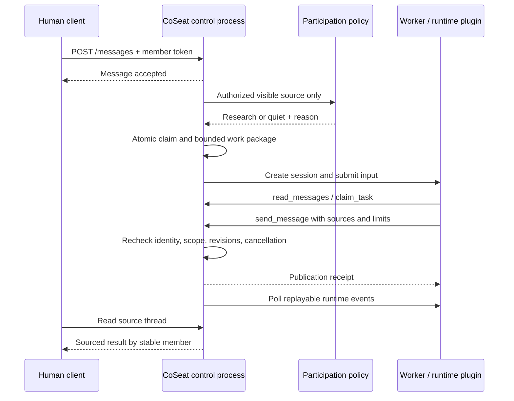

# 可运行的群聊调研协议切片

这是开发原型，不是日常自主服务。合成身份 Alex（human）与 Sam（agent）在 `design-room / runtime-design` 线程中使用显式、限时一小时的开发 Grant。没有默认企业授权策略，也没有项目许可证选择。

## 运行

环境：Node.js >= 24.14.0、npm。Windows 使用 `npm.cmd` 也可以。

```sh
npm ci --ignore-scripts --registry=https://registry.npmjs.org --cache .npm-cache
npm test
npm run demo
npm run demo -- --pi-mock
```

最后两个命令启动两个不同 PID 的 Node 进程，使用临时端口，并在结束时关闭进程。输出含源线程、实际成员、Run、发布回执、事件以及合成来源。固定资料不构成实际调研，`fixtures.invalid` 地址不会被访问。

需要手动交互时先 `npm run build`，再在两个终端运行：

```sh
npm run dev:control
```

```sh
npm run dev:worker
```

默认分别监听 `127.0.0.1:4317` 和 `127.0.0.1:4318`。Worker 默认 fake；PowerShell 中可先设当前进程环境变量 `$env:COSEAT_PROVIDER='pi-mock'`，再启动 worker。启动入口必须显式带 `--dev-fixture`（npm 脚本已包含）；不接受真实模型 provider。没有公网监听、TLS、正式身份认证或凭据配置流程。

发送一条自然消息，不需要 @ 或任务工单：

```powershell
$body = @{
  conversationId = 'design-room'
  threadId = 'runtime-design'
  text = '请调研一下插件的取消确认与成员身份边界'
  clientEventId = 'manual-001'
} | ConvertTo-Json
Invoke-RestMethod -Method Post -Uri 'http://127.0.0.1:4317/messages' `
  -Headers @{ Authorization = 'Bearer dev-fixture-alex' } `
  -ContentType 'application/json; charset=utf-8' -Body $body

Invoke-RestMethod -Uri 'http://127.0.0.1:4317/messages?conversationId=design-room&threadId=runtime-design' `
  -Headers @{ Authorization = 'Bearer dev-fixture-alex' }
```

这些是公开的合成测试令牌，不能用于保护真实数据。认证主体来自服务端 token 映射，不能由请求体 `authorId/memberId` 冒充。Guest 有独立合成身份，但没有这个线程的权限。

## 模块与边界



- `src/control/` 是消息、成员、Grant、认领、Run、待批请求与回执的唯一事实持有方。本轮为单进程内存 Map，没有数据库。
- `src/participation.ts` 是独立于 harness 的确定性开发策略。它对可见消息判断明确的调研意图，闲聊、否定意图及 Agent 发起消息保持安静。中文/英文关键字不是已验证的语义相关性模型；会漏接隐含任务。WorkMode 不参与授权。
- `src/worker/` 只通过 CoSeat HTTP API 读写业务对象。执行端没有控制面存储导入或数据库/管理凭据。SDK 内部工作单元不创建成员。
- `scripts/process-pair.ts` 为双进程验证清理继承环境，仅传运行必要系统变量和合成配置。操作系统本地权限没有通过应用 ACL 实现；同一机器/用户仍能访问本机资源，不能据此宣称已验证物理隔离。

## 薄协议

`src/contracts.ts` 定义 `coseat.runtime.v0`。插件与适配器是一个模块，没有插件市场或第二层框架。

| Worker HTTP | 语义 |
| --- | --- |
| `GET /capabilities` | provider/version、协议及选配能力 |
| `POST /sessions {work}` | 为稳定 member/task/run 创建 session；同 run、同工作包幂等 |
| `POST /sessions/:id/input {input}` | 接收输入；`input_received` 和 `input_applied` 分开 |
| `GET /sessions/:id/status` | 查询实际插件状态 |
| `GET /sessions/:id/events?after=N` | 按 session 的递增序号补读事件 |
| `POST /sessions/:id/cancel` | 受理与 stopped 分开；运行中不会立即报已停止 |
| `POST /sessions/:id/append`, `/pause`, `/resume` | 本切片统一返回 501，不假成功 |

事件包含 session/run、唯一 ID、序号、状态与时间，种类包括输入收到/应用、状态、输出、审批请求、失败和停止。工作包绑定 member/task/run/source/revision/contextRevision/grant/tools/budget/route/constraints。缺少关键字段或不匹配时拒绝。checkpoint 类型只定义 provider/version/session/opaqueRef，本插件明确不提供 checkpoint/resume；不承诺跨 harness 内部状态迁移。

CoSeat→Worker 控制令牌与 Agent→CoSeat 成员令牌分开。当前是显式开发夹具，不是生产认证设计。

| Agent 工具 | CoSeat API | 服务端约束 |
| --- | --- | --- |
| `read_messages` | `GET /messages?...&runId=...` | 当前成员、线程范围、run 所有者、Grant 和来源版本 |
| `send_message` | `POST /tools/send` | 由 run 绑定源线程与作者；重新校验权限、版本、取消、来源和回执 |
| `claim_task` | `POST /tools/confirm-claim` | 校验绑定 run/source/revision 与当前授权后确认既有认领；绝不创建或派发新 Run |
| `request_approval` | `POST /tools/request-approval` | 同 run 和线程；只创建 pending 请求，不批准、不扩权、不自动恢复 |

人和 Agent 都通过同一 `authorize` 检查读取、发送等应用动作。可见性在参与判断、派发和每次业务工具调用处检查；来源、Grant 及成员关系在发布前再验。测试可直接改变内存事实以验证失效，但尚无完整编辑/撤回/退群管理接口和已加载上下文清理机制。

初次认领仍由参与策略或 `POST /tools/claim` 原子创建；Worker 的 `claim_task` 只使用确认接口。取消接口会补读执行端事件并对账：已完成且已有发布回执时返回 `completed / too_late_completed`；等待 capabilities、尚未发出创建会话请求时返回 `stopped_before_session` 和控制面“未启动”证据，不伪造 runtime 停止事件。创建请求已在途或结果不明时，不能用缺少 session ID 推断未启动。

VIT-131 更新：显式 `/tools/claim` 必须提交 `sourceRevision`，可选受控 `slot`；返回独立 Task 和已有 owner 状态。规范工作键不含 contextRevision，Task、Run 与待派发关系同事务持久化；完成回执不能借新 revision 自动复跑。详细契约与单控制面边界见[工作认领说明](work-claims.md)。

取消会启动或复用每个 Run 唯一的后台事件轮询，即使原派发轮询已经失败退出，也会继续读取最终停止事件，无需再次点击取消。并发请求共享取消 RPC 与正在进行的事件读取；读取重试不会重发取消。对账窗口从首次取消开始，默认 5 秒，重复请求不会延长；已开始的 HTTP 请求另受 5 秒超时限制。窗口耗尽仍无证据时标记 `unknown / runtime_stop_unconfirmed` 并停止后台重试，保持发布封锁，不假报已停止。此机制仅在当前控制进程内有效，不是持久恢复系统。

## 可复现证据与限制

2026-11-02 在 Windows / Node 24.14.0 / npm 11.9.0 执行。`package-lock.json` 固定传递依赖，安装关闭 lifecycle scripts。

| 层级 | 实际执行 | 已验证 | 不代表 |
| --- | --- | --- | --- |
| fake adapter | 确定性函数＋真实 CoSeat HTTP 工具 | 消息、相关/静默、权限、认领、幂等、事件、取消、回源 | SDK 或真实研究能力 |
| 真实 SDK＋模拟模型 | pi 1.4.0 SDK＋官方 faux provider；四轮模型响应、三次实际工具调用 | 工具白名单、工具结果进入下一轮、真实 HTTP 回源、SDK 取消与 settled；无外部 fetch | 真实模型质量、速度、成本或网络研究 |
| 真实模型调用 | 未运行 | 无 | 不消耗真实模型费用；未配置或复用个人模型凭据 |

`npm test` 的覆盖点：

- 无 @ 自然消息触发、闲聊/否定意图安静；后台工作未完成时其他消息仍可进入。
- 重复输入事件、12 个并发 claim、重复结果和重放事件仅产生一个结果；不同 payload 重用键被拒绝。
- 身份冒充、未授权读/发/认领/取消被拒；不可见消息不进入参与判断或派发。
- 来源与 Grant 版本改变、撤权、过期、成员移除后拒绝读取/发送。
- 取消先阻断发布；延迟任务未结束时保持 `cancel_requested`，结束后才记录 `executionSettled`；取消后迟到结果被拒。
- 选配能力明确不支持；审批保持 pending；拒绝没有停止证据的事件。
- fake 与 pi-mock 都由两个独立 PID 跑完整闭环。

进程内 Map 的去重与原子认领只覆盖同一次运行；没有事务型持久 outbox、租约、跨进程竞争控制或重启恢复。断线后若无法确认执行状态，控制面标 `unknown` 并拒绝新发布，不声称已停止。已经收到发布回执的消息不会因后续取消被撤回。停止证据只覆盖本插件的 SDK/函数及其 awaited API 调用，不是任意子进程或外部副作用的停止保证。

尚未实现：真实搜索/资料抓取、完整 IM UI/持久投递、语义参与质量基线、完整编辑撤回与已加载上下文失效、审批决定与恢复、多 Agent 互补工作、完整防循环预算、持久恢复、第二 harness、跨设备部署与正式身份/密钥管理。当前跳过 Agent 发起消息只提供基本防自唤醒，不能当作完整防循环实现。

本切片提供 VIT-103/105/106/107/108 的部分实现与 VIT-112 的部分退出证据。VIT-101 正式默认授权、VIT-102 完整采用核验和 VIT-104/109/110/111 等前置仍未完成；不变更 Linear 的原依赖或 Backlog 状态，也不宣称 VIT-108/112 全部验收通过。
