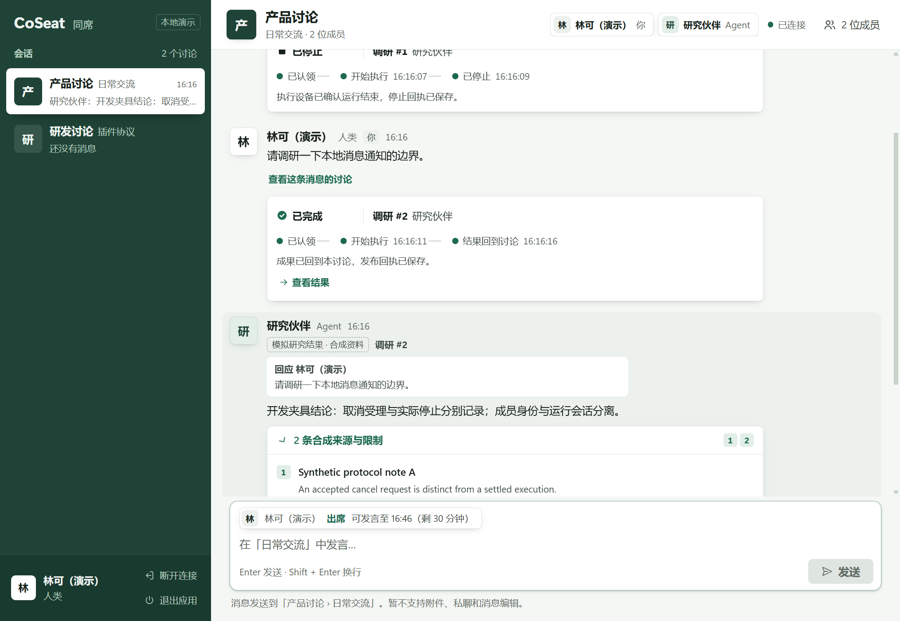
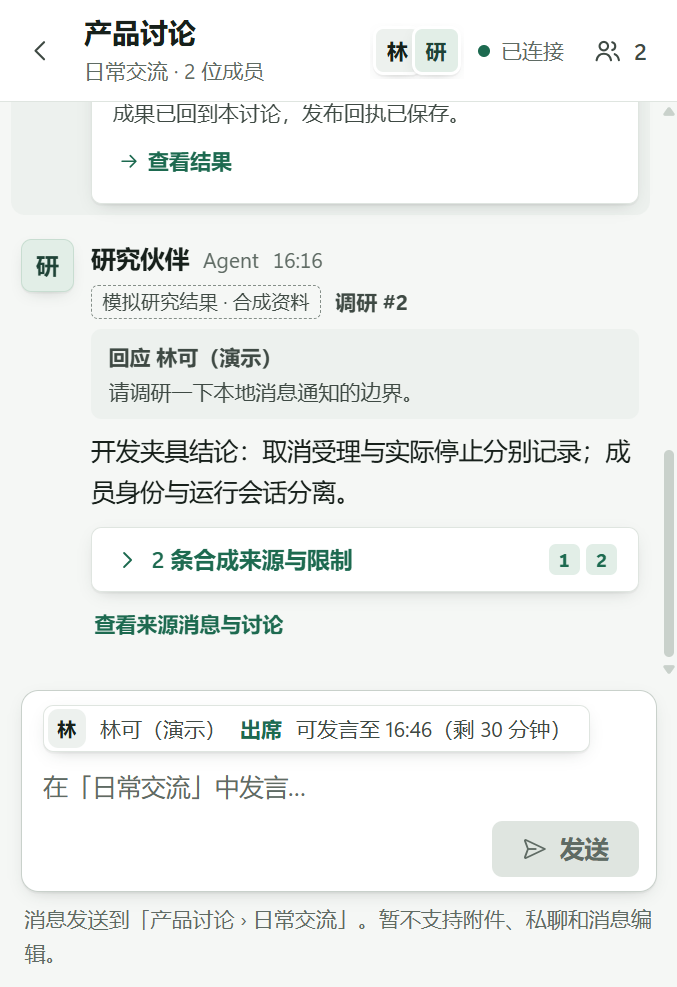
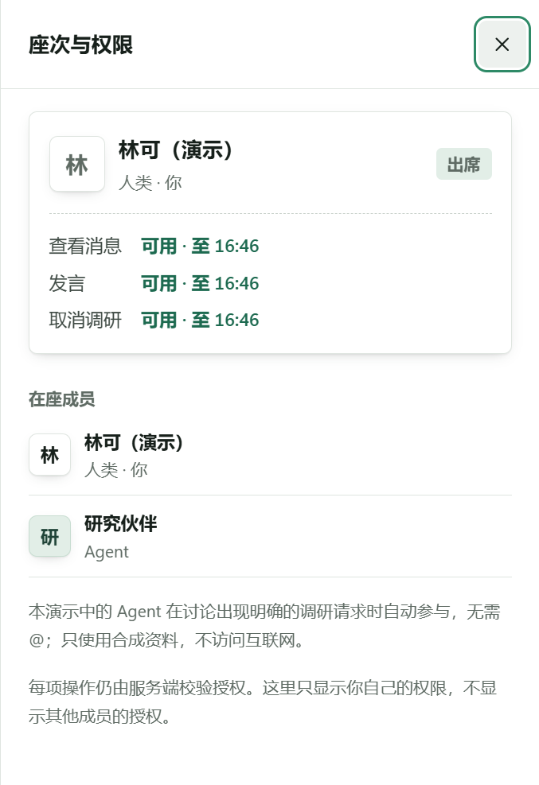
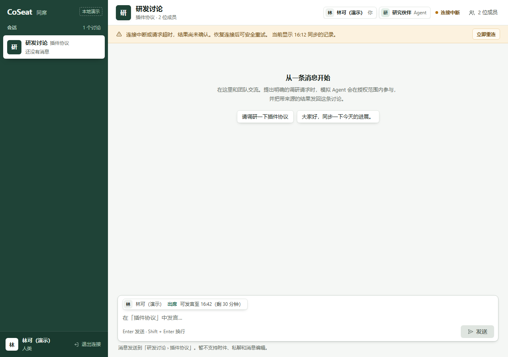

# Team IM redesign and review fixes — 0.1.2

2026-11-03. This branch retains the user-directed Claude UI redesign and fixes the subsequent review findings. Base: PR #4 `94016c919560b6ea2af3c22863b01b11bad9b310`, depending on PR #3 `d436c95ed33bb061c459c8acdddf5486be493fc9` and PR #2 `c080a2faada1d688b684973a7b7d8a31cf8ec1cc`. Local tests are not a substitute for review of these unmerged dependencies.

## Behavior

- Conversation previews, member identities, grouped messages, research event steps, result quotes and an optional source/member details pane retain the team IM structure. People and agents remain peer members; their permitted actions differ. Synthetic research and fixture sources remain explicitly identified.
- Known read deadlines now expire each cached scope independently, including while offline or waiting for a session response. Expired room messages, drafts, previews and details are removed from the active UI state; other authorized rooms remain usable. A delayed session response cannot move the known server clock backwards or revive expired content. Focus/visibility restoration rechecks deadlines. This does not change any server grant or credential lifetime.
- Overlay details panes use dialog semantics, an inert background and contained Tab/Shift+Tab focus, restoring focus on Escape/close. Above 1179 CSS pixels the three-column pane remains nonmodal. Crossing the breakpoint updates the behavior.
- Product/design documents no longer prescribe Chinese-first. The current demo is in Chinese; market, default locale and first supported languages remain undecided. Strings have not yet been extracted to an i18n layer.
- Version 0.1.2 identifies the new artifact. Previously delivered 0.1.0 and 0.1.1 binaries are preserved. No additional npm or Rust dependency was introduced; Cargo.lock changes only the application version.

## Checks on the final application code

| Check | Result |
| --- | --- |
| TypeScript build and JavaScript syntax | Pass |
| Backend, development Node 24.14.0 | 49/49 pass, completed 08:11:23 UTC |
| Backend, bundled Node 24.22.2 | 49/49 pass, completed 08:02:44 UTC |
| Chromium browser regression | 15/15 pass, completed 08:13:05 UTC |
| Rust release tests | 3/3 pass |
| Clippy release, all targets, `-D warnings` | Pass |
| Rust format check | Pass |
| NSIS Windows x64 installer build | Pass, completed 08:13:35 UTC |

The 15 browser cases include the original IM workflows, the redesigned activity/details/permission flows, and four added review regressions: a selected scope expiring offline, all scopes expiring while polling is stalled, a delayed response for an expired background scope, and modal/nonmodal keyboard behavior. Short deadlines are local test fixtures; system time and the demo's 30-minute ceiling are not changed.

Final pre-commit inspection also removed stale contents from hidden detail DOM nodes. The strengthened expiry regression checks the entire app DOM, not only visible messages. Backend/browser/build and installed WebView2 checks were rerun after that final frontend change. Bundled Node backend and Rust source/dependency versions are identical to their successful checks listed above.

One intermediate run failed because a test route was still forwarding a request when its mock service shut down. The harness now drains routes and closes the page before stopping the service. Forwarding failures omit authorization headers. The complete 15-case suite passed after that correction; the intermediate failure is not counted as a pass. Traces and video remain disabled.

## Actual Windows installation and WebView2

Installed into a new isolated test directory after confirming no existing CoSeat installation, protocol or process. No existing client was overwritten. Final installed tests completed around 08:16 UTC:

- Sending, duplicate submission, synthetic result/source display, cancellation followed by the Worker stop receipt, conversation/draft switching and reload/reconnect passed.
- Service scope rejection, blocked external navigation/fetch/new windows, rejected arbitrary IPC URL and absent shell privilege passed. Browser storage and cookies remained empty.
- The native window was physically resized to a narrow width. No horizontal overflow; the overlay dialog's inert background, Tab/Shift+Tab containment and Escape focus restoration passed in real WebView2.
- Pausing only this test application's bundled mock control process produced an outage state; resuming it restored the connection. No OS network setting was changed.
- Closing hid the actual window. A new notification appeared in this application's Windows notification history. Activating its registered opaque protocol restored the window to freshly authorized source content. Repeated activation remained usable; disconnected and unknown references cleared content and showed a safe explanation.
- Normal application exit and uninstall passed. At 08:16:45 UTC: no test executable, registered protocol, owned processes or inspection listener remained. The set of other current-user uninstall entries matched its pre-install snapshot.

### Explicit limits

**The 0.1.2 tray left-click/show/quit interaction was not verified.** UI Automation found the Windows hidden-icons entrance, but could not locate the CoSeat icon after opening it, including a bounded retry allowing for the menu animation. No unrelated icon or settings were changed. The unchanged native tray implementation has historical 0.1.1 evidence, but that is not reported as a new 0.1.2 pass. The test app exited through its normal `desktop_quit` action before uninstall.

**Actual Windows banner/Notification Center card display and click remain unverified.** Notification history and registered-protocol activation prove the source recovery path, not card presentation or clicking. No further OS settings exploration was performed. Cold-start activation of an old notification and natural 30-minute expiry were not rerun for 0.1.2; 0.1.1 evidence is historical only.

Keyboard/dialog checks are accessibility regression tests, not full screen-reader or high-contrast certification. No real model, remote deployment, production credentials, live research, persistent login or authorization extension was used. Existing npm dependency advisories discussed in PR #3 are not declared fixed or irrelevant to all future network tools; this installer still bundles the fixed official Node runtime and the mock-only backend, without pi production modules.

## Screenshots

These contain synthetic demo members/messages only. The first three are actual installed WebView2 captures; the expiry image is the local HTTP browser fixture.

## Artifact

`CoSeat Demo_0.1.2_x64-setup.exe`: **25,810,182 bytes**, **unsigned**.

SHA-256: `d1b1ad105e19742e54a6d4f3fb936debd0f629786f449a8d8517e4f274344120`

Local build output: `src-tauri/target/release/bundle/nsis/`. No public Release or new download service was created. The installer embeds the final application code tested above; later edits are test-harness/docs/evidence only. No signing or Windows warning bypass is claimed.

For remaining manual verification after a normal trusted installation: close the window, use the CoSeat tray icon to restore it, exercise Show and Quit, then run a fresh mock research request while hidden and inspect the actual notification card. A successful card click should revalidate and open the source conversation; expired/disconnected references must not recover old content. Stop if a security warning prevents running, and report the exact message rather than bypassing it.

## Local evidence digests

Logs are kept locally, not published with machine paths or temporary request diagnostics. These final successful logs can be matched by SHA-256:

| Log | SHA-256 |
| --- | --- |
| ui-012-backend-final.log | 1b8913f8033b56e2f08df5d92eabd258e5eed465f23734266757776aced269c5 |
| ui-012-browser-final2.log | a56bc6be8499b7d13834a9694cb139281398f9fd638b88329230b11355b848cf |
| ui-012-bundled-node.log | bd95d54cd22f21c9b6eebb866c99c1b7327c5608b09b34908ffdf9dd2850554e |
| ui-012-build-final.log | 14d0503a3ea25eb97da50c543cfe99de76396635903720c239e7f15f15b537e0 |
| ui-012-rust.log | 32c6c7b8c237ccccf1ace521109c027e2ba4cf8cc439865c21f34d8f4d79f3da |
| ui-012-clippy.log | 0217d9c862e6613d54a60301dec8ec585ea577d26a8936255ec9b3d3275dcbf1 |
| ui-012-webview-final.log | 4a38b24c39ad3ae6728e99d8ca0328f03ad0cb1bfc529b10136322cc1307731b |
| ui-012-native-ui-final.log | b4be1734184f33077f6e521c432d625869270533223c27df902c082e4c48c269 |
| ui-012-notification-final.log | c0ae58b3b379f855ef0c5d43834334da1ef72e053b3400d6daee2a1589b10352 |
