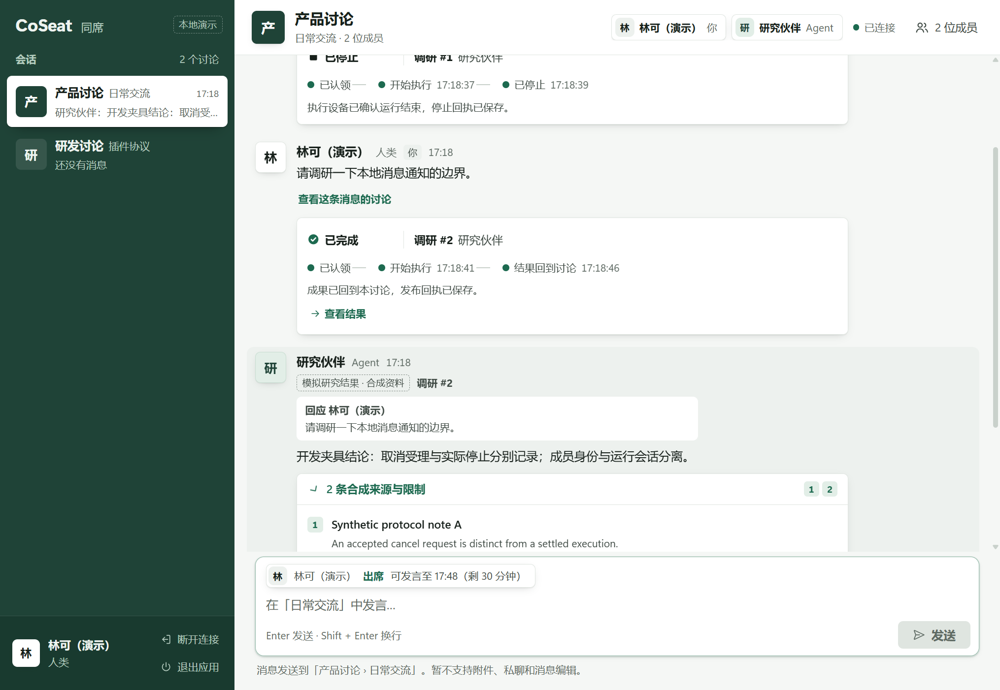
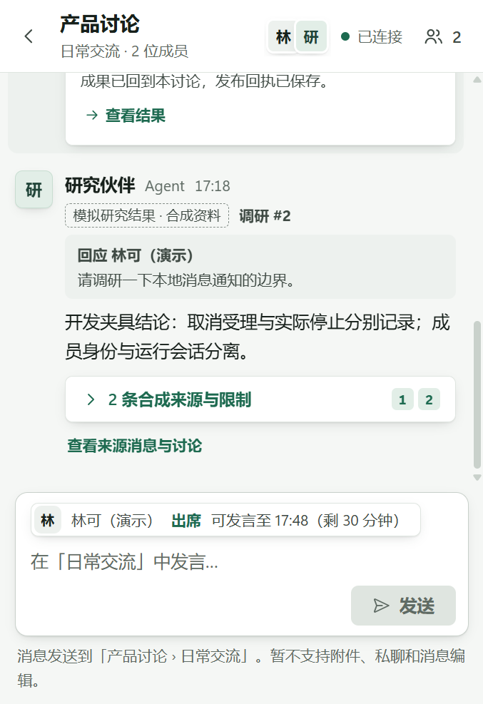
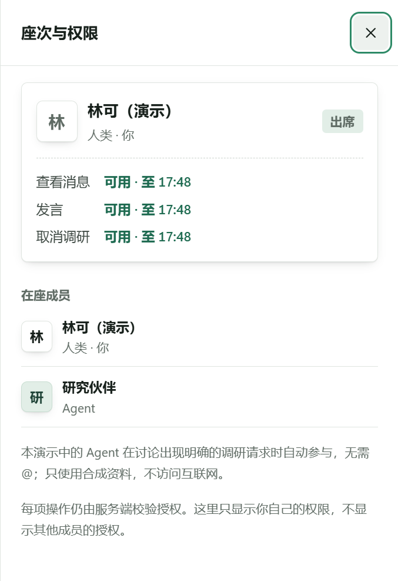

# Team IM integration — 0.1.3

2026-11-03. PR #5 merges reviewed main `1f8408a70e32652995e4f050ee09c3f6834fd523` into the redesigned UI at `5930fbdd56931bc56c7464d949bb94b08ad5d1e5`. PR #2, #3 and #4 are already merged. This is a new, unsigned 0.1.3 installer; prior 0.1.0, 0.1.1 and 0.1.2 artifacts are preserved. The 0.1.2 checksum was rechecked unchanged.

## Integration

- Retains the Claude team IM redesign, human/Agent peer identities, synthetic sources, per-scope read expiry (including hidden detail DOM), and responsive keyboard focus containment. Market, default locale and initial supported languages remain undecided.
- Preserves main's cancellation acknowledgement merge into the complete Run, terminal states already observed by polling, and the revision guard that prevents an older snapshot batch from overwriting an acknowledgement. The guard now covers the redesigned multi-room refresh batch.
- Preserves main's single-consumer notification drain and pending wake-up flag, including activation during an empty IPC response or failed request. A new integration regression opens a narrow modal, activates a notification during the empty response, and checks that the source changes, the modal closes, stale member DOM clears, background inertness is removed and message input remains usable.
- Denial-audit persistence, engine, store and backend tests match main exactly. Native Rust implementation and npm dependencies are unchanged; Cargo.lock changes only the application version.

## Full validation of the integrated application code

| Check | Result / completion UTC |
| --- | --- |
| TypeScript build, development Node backend | 55/55, 09:12:27 |
| JavaScript syntax | Pass, 09:12:27 |
| Chromium browser regression | 26/26, 09:14:44 |
| Bundled Node 24.22.2 backend | 55/55, 09:16:18 |
| Rust release tests | 3/3, 09:12:39 |
| Clippy release, all targets, warnings denied | Pass, 09:12:43 |
| Rust formatting | Pass, 09:12:43 |
| Windows x64 NSIS build | Pass, 09:16:14 |

The browser suite contains 18 IM cases and 8 notification cases. It includes expiry while offline/stalled, delayed session responses, clearing hidden DOM, narrow/large keyboard behavior, cancellation history/terminal-state races, notification wake-up/error/expiry races and the new modal-to-notification integration case. Short expiry fixtures do not change system time or the installed demo's 30-minute limit. No application source changed after these checks; subsequent edits are documentation and evidence only.

## Actual installed Windows validation

After confirming no existing CoSeat process, installation, protocol or inspection listener, installed into a fresh workspace-only test directory. The WebView2 inspection endpoint was enabled only for this test process on loopback. All checks passed:

- Real send, duplicate submission, synthetic result/source display, cancel followed by actual Worker stop receipt, room/draft switching and reload/reconnect.
- Service scope rejection, blocked external fetch/navigation/new windows/arbitrary IPC URL, no shell privilege, and empty browser storage/cookies.
- Physical native window resizing, no horizontal overflow, modal semantics, inert background, Tab/Shift+Tab containment and Escape focus restoration.
- Pausing and resuming only this installation's mock control process produced outage feedback and recovery, without changing OS networking.
- Actual Windows notification history plus registered-protocol activation restored a hidden window to freshly authorized source content. Repeated activation remained usable; disconnected and unknown references failed closed and cleared cached content.
- A second real protocol activation during delayed delivery of an already-empty native IPC response survived the race: source restored, one bounded consumer, no stranded loading/blank window. The test restored its temporary invoke wrapper afterward.
- Normal application exit and uninstall completed at **09:19:16 UTC**. No test executable, protocol, owned process or inspection listener remained. Other current-user uninstall registry entries matched their pre-install snapshot.

**Not verified:** actual Windows banner/Notification Center card display and click; tray icon/menu interactions for 0.1.3; natural 30-minute expiry; cold-start old notification; full screen-reader/high-contrast behavior. Notification history and protocol activation are not evidence of card presentation/clicking. Prior tray automation could not locate the icon; no further OS-settings exploration was attempted. Historical 0.1.1 results are not counted as new passes.

No production identity, remote service, paid model, persistent login, authorization extension or OS security-setting change was used. Existing dependency advisories are not declared generally fixed; the installer bundles the verified official Node runtime and mock-only backend without pi production modules. No public Release or download service was created.

## Screenshots

Actual installed WebView2, synthetic demo content only:

## Artifact

`CoSeat Demo_0.1.3_x64-setup.exe`: **25,802,175 bytes**, **unsigned**.

SHA-256: `78f0bbb8a74cea0d3ceb36b5cb8a2f80820d0ddd7c46fe7d42f660ac034ea312`

Local output: `src-tauri/target/release/bundle/nsis/`. See [Windows build/run instructions](../client-windows.md). No claim of code signing or bypassing Windows warnings is made.

## Local evidence digests

Raw logs remain local; they are not published with machine paths or temporary request diagnostics.

| Log | SHA-256 |
| --- | --- |
| ui-013-backend.log | 59a30d2ec4f785328f905f31fc11164d899280259020a6a276ec072e0ed3faa7 |
| ui-013-browser.log | eb2567fa4696126ef175971e59867ae345706cc77a8fdd7129eefb68c40ea5c1 |
| ui-013-bundled-node.log | b201a0bf880417bed604478972b7626de742a66a8767b421672b52133ac1d5f9 |
| ui-013-build.log | 775e8b096dd5c21f6ef0e385a6d9c486870208b39b87ba817265d427091f7a92 |
| ui-013-rust.log | 1f5aba2e3dee54c8103841f706b1f4082efed6c5dbeb1c9ca291906a75559325 |
| ui-013-clippy.log | 6dd3f217070f04e853aff94ee9299255d8b8d7ac800a67228b721559ae3f94cd |
| ui-013-webview-final.log | a6e89908365712d41dfd17c8e583ce6c4225386f9efe64921f4cd6c8e65b6076 |
| ui-013-native-ui-final.log | 692161f92feb6ae06cb6cf443333f3279449b7e118d377852dfcae29f5e74641 |
| ui-013-notification-final.log | 01ca573f419518e79d4f81b8762b7402065e49580942899b28f42cbf40632ade |
| ui-013-notification-race.log | a7c8c0ca23bd87b42cf861e4293536c1f4b0d25cd697af04e07e972777e95c2f |
