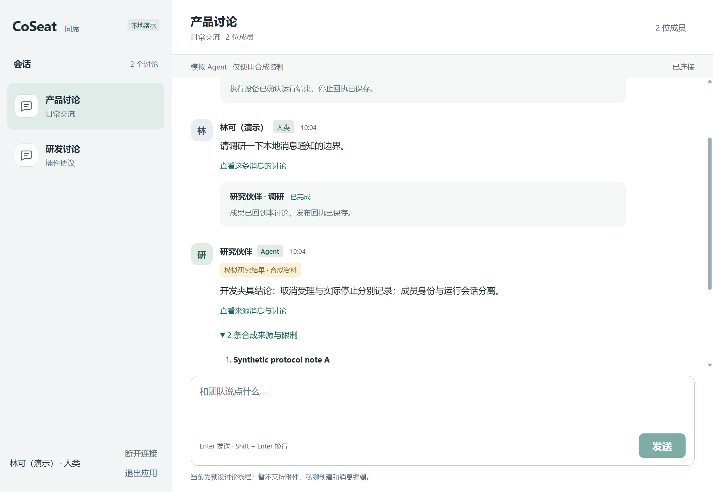
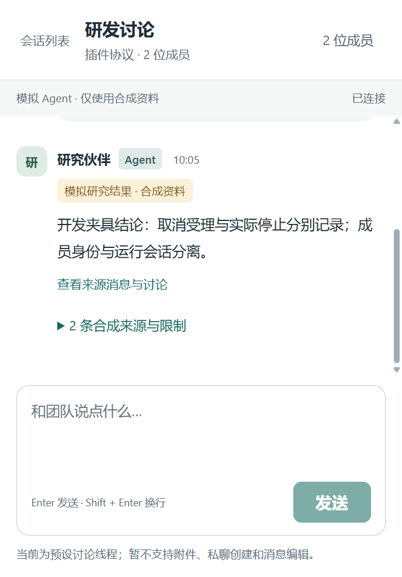

# Windows 0.1.1 通知恢复与托盘验收

CoSeat Demo 0.1.1，Windows x64、当前用户 NSIS、**未签名**。独立 Draft PR #4，继续依赖 PR #3 `d436c95ed33bb061c459c8acdddf5486be493fc9` 与 PR #2 `c080a2faada1d688b684973a7b7d8a31cf8ec1cc`。未合并、未部署。0.1.0 原安装器及其[历史验收](2026-11-03-windows-client.md)保留。

安装器 `CoSeat-Demo-0.1.1-windows-x64-setup.exe`：**25,785,627 字节**。

SHA-256：`d29c5acd0862dc58d932ba8d58bad523e73d1bd85dcb2a59b924e9c377dc94b7`。

最终构建完成：2026-11-03 **02:03:36 UTC**。之后没有再修改安装器中的应用代码；源码测试辅助脚本和本文档单独记录验收。

## 实现与权限边界

0.1.0 通知插件的监听器不能覆盖通知中心及冷启动。本版改为官方 Windows WinRT Toast 的 `activationType="protocol"`，由安装器注册固定当前用户协议 `coseat-demo-notice`。Windows 可把通知激活交给已运行实例或启动新实例，机制不依赖横幅监听器的存活时间。依据：[Microsoft 通知内容](https://learn.microsoft.com/en-us/windows/apps/develop/notifications/app-notifications/app-notifications-content)、[Tauri Deep Linking](https://v2.tauri.app/plugin/deep-linking/)。这项机制已经实现，但真实系统卡片点击仍有下述验收限制。

- 提示只有固定通用文案。URI 仅含随机 128-bit 引用，严格校验格式，不含消息、会话名、路径、token 或网络目标。
- 引用到会话的映射仅在内存，最多 128 项，到期不超过原演示截止时间。Windows 通知本身也设置同一过期时间。
- 激活后先检查当前连接状态、引用期限和真实服务端 `/session` 授权，再由共享连接层刷新来源消息；成功后恢复窗口。隐藏期间不先展示旧缓存。
- 断开、未知、到期或重启前引用不会授予访问权，会清空旧消息并显示说明。冷启动保持未连接，由用户自行进入新的本地模拟；不会恢复旧凭据或延长远程试点。
- 没有任意 shell/fs/http/URL 桥，没有远程 JS、自动启动或新的持久凭据。前端 capability 仍只有主窗口事件监听/取消监听。协议不是网络端口，不在运行时修改注册项。
- Node 路由校验也收紧为相对路径，拒绝绝对回环 URL 和反斜杠。Rust 原本已拒绝这些输入，本项是纵深防御，不是确认存在的可达漏洞。

## 最终代码回归

2026-11-03 02:02–02:10 UTC，Windows 11 / Rust 1.95.0 / MSVC 18 / WebView2 156.0.4314.58：

| 检查 | 结果 |
| --- | --- |
| TypeScript build、JS syntax | 通过 |
| 完整后端，开发 Node 24.14.0 | 49/49 |
| 完整后端，随包 Node 24.22.2 | 49/49 |
| 完整浏览器回归 | 8/8；包含到期、只读、重试、焦点及窄屏 |
| Rust release / Clippy / fmt | 3/3；`-D warnings` 与 fmt 通过；包含通知格式、期限、重启失效和跨会话拒绝 |
| 最终安装器 | 实际安装成功，测试目录独立，安装前确认没有已有 CoSeat 安装或同名协议 |
| 安装后 IM 冒烟 | 发送、重复提交去重、合成来源、取消及真实停止回执、切换/草稿、刷新重连通过 |
| 安装后边界 | 未分享 scope 返回 403；外部 fetch/导航/新窗口、任意 URL IPC、shell 插件均拒绝；浏览器存储/cookie 为空 |
| 安装后真实断线 | 仅暂停本次模拟控制进程，显示中断；恢复后自动重连通过，未改网络设置 |
| Windows 通知入口 | 从本应用 Windows 历史获取实际新通知，确认 protocol 激活类型；用系统注册协议激活，关闭隐藏后恢复到来源讨论通过 |
| 通知重复点击入口 | 同一引用重复激活后仍在来源讨论，无残留加载层 |
| 断开/未知引用 | 明确反馈、清空缓存消息；不会自动重连 |
| 冷启动旧引用 | 实际结束应用，再通过 Windows 协议启动；显示旧演示不可用，消息为空，未自动连接 |
| 原生窄窗口 | 实际缩窄后 CSS 393×564，scrollWidth 393；会话切换及输入可用 |
| 最终包托盘操作 | 原生鼠标实际左键恢复、右键显示、右键退出通过；检查原窗口可见性及测试进程退出 |
| 最终卸载 / 清理 | 02:10:06 UTC 结束，退出码 0；应用文件、通知协议、测试进程和检查端口均移除；其他应用卸载注册项集合无差异 |

可复现脚本：`scripts/desktop-smoke.mjs`、`scripts/desktop-notification-smoke.mjs`。后者读取**本应用**的 Windows 通知历史并经 ShellExecute 激活真实注册协议，不注入 JS 通知回调。临时检查端口仅为测试启动设置，发布应用不自行开启。PowerShell 辅助脚本需要正常本机桌面会话；受限制执行环境最初连接自己的回环测试端口返回 EACCES，获得本地测试执行权限后全量重跑通过，未绕过自动批准拒绝。

最终日志校验（原始日志保留本地，不公开机器路径）：开发 Node 后端 `3a2ead0f7e20b61b869ab6c3cefa6b2b144c34ef3cfc45a8195d9a3c7e55fe96`；随包 Node 后端 `b4e8fcc90ca1a7628766549de9bc8346e07ee56c307b23d9055f3cd819e24cda`；浏览器 `4b6c303dd1249f0e9b3d5cf316b69f7e46b63fb68ffa9009a6c344601fd0e560`；安装后通知入口 `01ca573f419518e79d4f81b8762b7402065e49580942899b28f42cbf40632ade`。全量结果分别结束于 02:03:13、02:04:26、02:04:02 UTC；最终安装后入口检查结束于 02:05:13 UTC。其后只修改文档及测试辅助脚本，应用代码和安装器没有改变。

## 实际托盘与未完成的系统通知验收

托盘通过原生鼠标打开溢出区，找到 CoSeat 自身图标，并实际操作显示/退出菜单。显示后检查原窗口可见；退出后检查本测试实例结束。UIAutomation 的单独 Invoke 曾不能打开本机溢出区，正常鼠标输入可以；没有更改任务栏设置。

**仍未通过：横幅/通知中心卡片的实际显示与鼠标点击。** 新通知已进入本应用 Windows 历史，`Setting=Enabled`，原生提交计数递增；但 UIAutomation 未观察到 CoSeat 横幅。正常 Win+N 以及点击本机通知区按钮也没有提供可观察的通知中心卡片。因此无法完成卡片点击这一层，具体环境原因未确定；不能说是用户关闭权限，也不能把协议入口通过当成卡片点击通过。没有工具批准拒绝，没有修改通知、请勿打扰或安全设置。此项保留待人工验证，PR 仍为 Draft。

最小人工验收：

1. 进入演示，在“研发讨论”发送“请调研一下通知”，立即切到“产品讨论”并关闭窗口。通知出现时点击，核对恢复到“研发讨论”。
2. 再发一次，等待横幅消失后从通知中心点该条记录，核对同样定位。若没有可见记录，可查看 Windows 通知/请勿打扰状态；本应用不会代改设置。
3. 保留一条记录，退出 CoSeat 后点击它；应打开未连接页面并说明旧演示不可用，不恢复旧消息。记录可能已被 Windows 到期清理。

安装版未等待完整 30 分钟自然到期；原生期限/来源校验单测、服务端与浏览器的到期/撤销测试通过，不等同这一项端到端实测。

## 审计与分发

新增依赖来自官方 crates.io：`tauri-plugin-deep-link 2.6.3`、`windows 0.62.2`、`uuid 1.29.0`；删除 notification 插件。Cargo 审计仍为 0 vulnerability 条目，5 informational 警告：proc-macro-error 1.0.4 / RUSTSEC-2024-0370、zbus_names 4.3.5 / RUSTSEC-2026-0371、zvariant 5.15.1 / RUSTSEC-2026-0370、zvariant_derive 5.15.1 / RUSTSEC-2026-0372、glib 0.18.5 / RUSTSEC-2024-0429。重新核对 Windows x64 过滤依赖图，五者均不在该图中；不推广到其他平台。

npm 仍是原有 3 包条目、9 公告（2 moderate、1 high），不是 3 个独立漏洞。详见[既有逐公告诊断](https://github.com/tianxingyang/ai-native-workspace/pull/3#issuecomment-6583282671)。安装包不带生产 npm 模块、不执行 pi；便携 Node 24.22.2 / Undici 7.30.1 只用于固定本地 mock。没有更换任何现有部署的 Node，也没有把结论推广到真实模型或任意网络工具。

安装器、README 和 SHA256SUMS 按版本独立保存。0.1.0 已上传 Library，但给用户发送附件时返回大小限制，**未送达附件**。未创建第三方下载服务或公开 Release。Library 分享操作需要明确接收人/工作区范围，未提供可直接返回给所有者的公共下载链接，因此没有猜测或编造链接。用户本机 Downloads/CoSeat 是当前可用交付入口；公开 Release 资产另需批准。

无生产凭据、设备身份、私有地址或真实资料进入公开源码/文档/截图。没有改动云服务、DNS、SSH、代理、证书、试点截止时间或模型额度。

## 最终安装实例截图

仅含合成消息；未截取用户桌面或其他应用通知。

