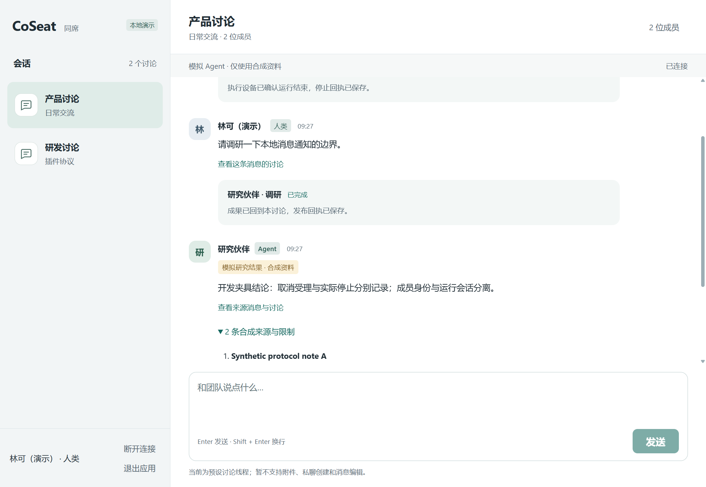
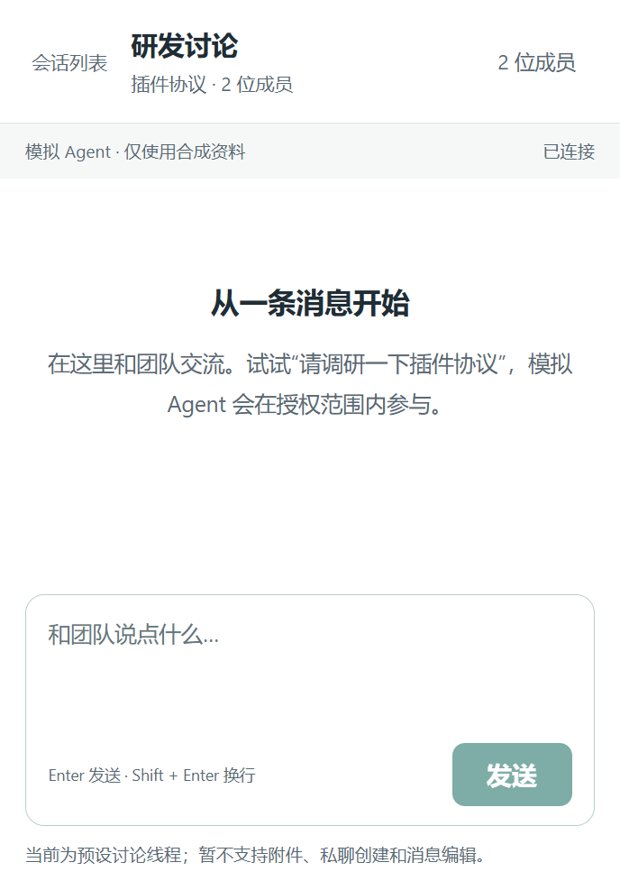

# Windows 安装版验收记录

版本：CoSeat Demo 0.1.0，Windows x64，NSIS 当前用户安装，**未签名**。依赖 PR #3 (`d436c95ed33bb061c459c8acdddf5486be493fc9`)，其下为 PR #2 (`c080a2faada1d688b684973a7b7d8a31cf8ec1cc`)。不合并、不部署。

交付文件 `CoSeat-Demo-0.1.0-windows-x64-setup.exe`，25,870,842 字节；SHA-256：`6dbf320e461f1f0d386cc5ae00198bde933f68f5de1858ca43b5d852667b52a6`。最后构建完成于 01:23:33 UTC，已对该安装器重新安装、冒烟和退出/卸载。Tauri 的安装二进制与未打包二进制仅有 3 字节 bundle 类型标记差异（NSS / UNK）；自带 Node 与后台 JS 文件逐字节一致。

## 自动化与安装验证

2026-11-03 UTC，Windows / Rust 1.95.0 / MSVC 18 / WebView2 156.0.4314.58：

| 检查 | 结果与边界 |
| --- | --- |
| TypeScript build、JavaScript syntax | 通过 |
| 全量后端（开发 Node 24.14.0） | 49/49；01:15:40 UTC 结束 |
| 全量后端（安装包 Node 24.22.2） | 49/49；01:16:04 UTC 结束；新增原生接口路由、无凭据文件、真实 sidecar HTTP/去重/通知消息事件/EOF 清理 |
| 完整浏览器回归 | 8/8；01:16:52 UTC 结束，包含失效/只读反馈、丢响应重试、取消回执、焦点和窄屏 |
| Rust release 单测 / Clippy / fmt | 1/1；Clippy `-D warnings` 和 fmt 通过，01:17 UTC 完成 |
| NSIS 构建与实际安装 | 通过；测试目录独立，无已有用户版本覆盖，安装退出码 0 |
| 安装后独立窗口 | 通过；运行安装目录内程序与自带 Node，无外部浏览器启动 |
| 安装后消息闭环 | 真实 HTTP/SQLite/独立 fake Worker；发送、双重提交去重、合成来源、实际停止回执、切换与草稿隔离、刷新重连通过 |
| 安装后权限边界 | 未授权 scope 返回 403；任意 URL 请求、shell 插件、外部 fetch/导航/新窗口拒绝；页面存储和 cookie 为空 |
| 真实断线恢复 | 仅暂停该次模拟控制进程，界面显示连接中断；finally 恢复进程后自动重连。未修改网络设置 |
| 实际窄窗口 | 原生窗口 resize 后 CSS viewport 393×564，scrollWidth 393，切换会话和输入可用；非浏览器尺寸模拟 |
| 关闭和单实例恢复 | 关闭后进程仍活、窗口不可见；再次启动恢复同一窗口 |
| 退出与清理 | 界面“退出应用”可结束；另测异常终止本测试客户端后，控制/Worker 子进程归零 |
| 卸载 | 退出码 0，测试程序文件删除；其他应用卸载注册项集合无差异。未声称对其他应用全部文件做逐字节对比 |

最后的包装补充只增加第三方许可副本，不改变应用行为。其后重新构建、安装及执行安装版冒烟检查；运行器、原生源码与共享 UI 没有在完整回归后继续修改。源码和安装器分开交付，安装器校验值随交付说明提供。

保留日志摘要校验：后端 `1934a3dac71cfb652442690f1a7cf4e3bdfb7cae490b229a443629cf86bc528b`；随包 Node 后端 `f64cbfbf46e5a6995ec2448d0273b52c129b1261d69892efb3662b79df5d198b`；浏览器 `b524fe4166b95f013baf132c5f336c2dc4c7be9e8baf4c9b8ff8b435fbab73b5`；最终安装实例冒烟 `a6e89908365712d41dfd17c8e583ce6c4225386f9efe64921f4cd6c8e65b6076`。原始日志保留在本地忽略目录，不发布包含构建机器路径的日志。

## 原生托盘与通知：保留未完成验收

- 实现托盘显示/退出菜单，Windows 的 NotifyIconSettings 已登记本应用的图标和 tooltip。
- 后台收到合成 Agent 新消息后，原生接收计数与通知提交计数递增；Windows WinRT 返回该应用通知设置为 `Enabled`，本应用通知历史和 `LastNotificationAddedTime` 确实更新。这证明 OS 接收，不证明屏幕横幅出现或点击回调。
- 当前自动化未能观察到 CoSeat 屏幕提示，也未能打开并点击其托盘菜单。原因尚不确定，**没有明确工具拒绝，也不能归因于权限关闭**。未更改系统通知、请勿打扰或其他应用设置。
- 因此，托盘菜单点击、屏幕提示点击定位会话均 **未通过验收**，不能把桌面全部功能记为完成。关闭隐藏和重复启动恢复是已独立验证的路径。
- 当前 [Tauri notification 2.8.0](https://docs.rs/tauri-plugin-notification/2.8.0/tauri_plugin_notification/struct.Notification.html) Windows 点击回调只在提示仍显示时支持；通知中心中的点击和退出后冷启动不支持，属于明确功能限制。
- 30 分钟自然到期未在安装版等待全程；到期/撤销反馈已有完整服务端和浏览器回归，桌面未另授到期豁免。

手工验收步骤：

1. 打开应用进入演示，关闭窗口；在系统托盘找到 CoSeat，分别验证左键恢复和右键“显示 CoSeat”。
2. 在“研发讨论”发送“请调研一下桌面通知”，立即切到“产品讨论”并关闭窗口。约 5–7 秒后，若系统展示提示，在其消失前点击，核对窗口恢复且定位“研发讨论”。
3. 若无提示，手动查看 Windows“设置 → 系统 → 通知 → CoSeat Demo”及“请勿打扰”；应用不会代改设置。通知中心记录可用于核对送达，但该处点击不在本版支持范围。
4. 托盘右键“退出并结束本地演示”，确认应用结束；再正常卸载本次测试安装。

## 依赖审计

- npm 仍为既有 3 包条目（pi-coding-agent 元漏洞、minimatch 10.2.6、Undici 8.10.2），聚合 9 条公告；2 moderate、1 high。新增 Tauri CLI 不在漏洞条目内。[逐公告诊断](https://github.com/tianxingyang/ai-native-workspace/pull/3#issuecomment-6583282671)仍适用于源码的 pi 路线，未在此分支擅自升级 pi。
- 桌面安装包不带生产 npm 模块，不运行 pi SDK；只运行固定 fake Worker。随包 Node 24.22.2 的 `process.versions.undici` 实测为 7.30.1。这不意味着未来任意网络工具、真实模型或远程控制已完成安全验证，也不修改任何现有部署的 Node。
- cargo-audit 0.22.2 对 Cargo.lock 报告 0 个 vulnerability 条目，但有 5 个 informational 警告：proc-macro-error 1.0.4 / RUSTSEC-2024-0370；zbus_names 4.3.5 / RUSTSEC-2026-0371；zvariant 5.15.1 / RUSTSEC-2026-0370；zvariant_derive 5.15.1 / RUSTSEC-2026-0372；glib 0.18.5 / RUSTSEC-2024-0429（unsound）。它们保留在跨平台锁文件，Windows x64 过滤依赖图中无这些包；不把此结果推广到 Linux。
- Rust、Node 上游许可副本随包；项目本身仍未选定开源许可证。无签名证书、无自动更新、无系统自启动。

没有生产 token、设备身份、私有地址或真实资料进入截图/源码/公开文档。没有触碰 DNS、SSH、代理、证书、云服务、现有试点截止时间或真实模型额度。

## 截图

以下来自实际安装实例的 WebView2，只含合成消息：

